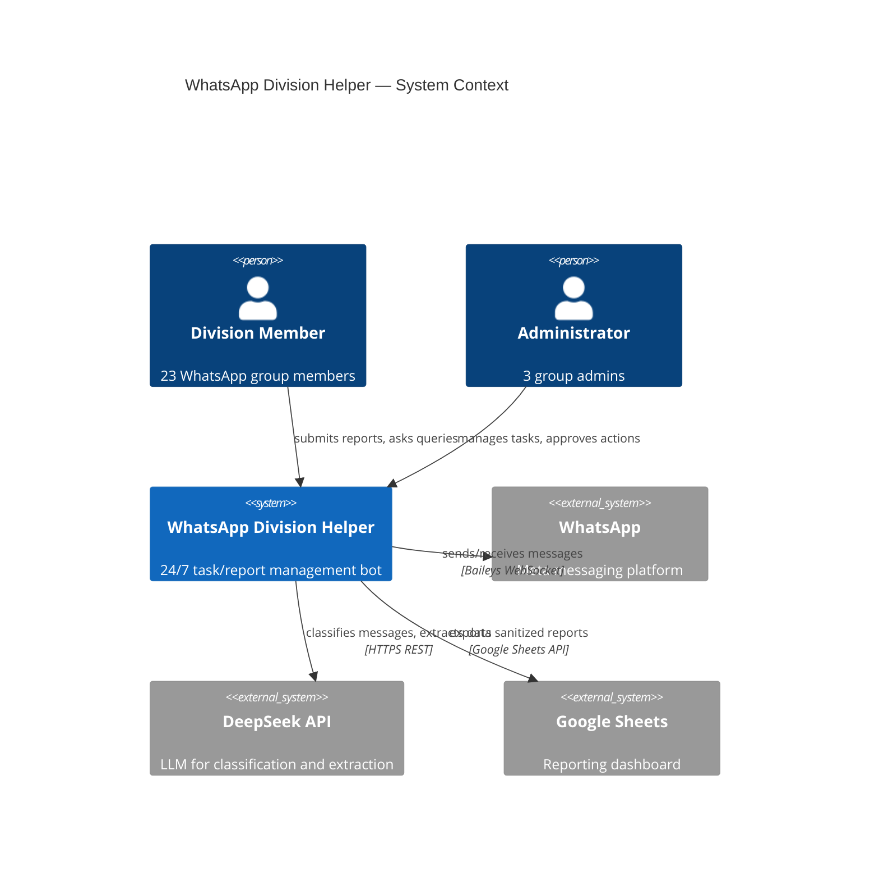
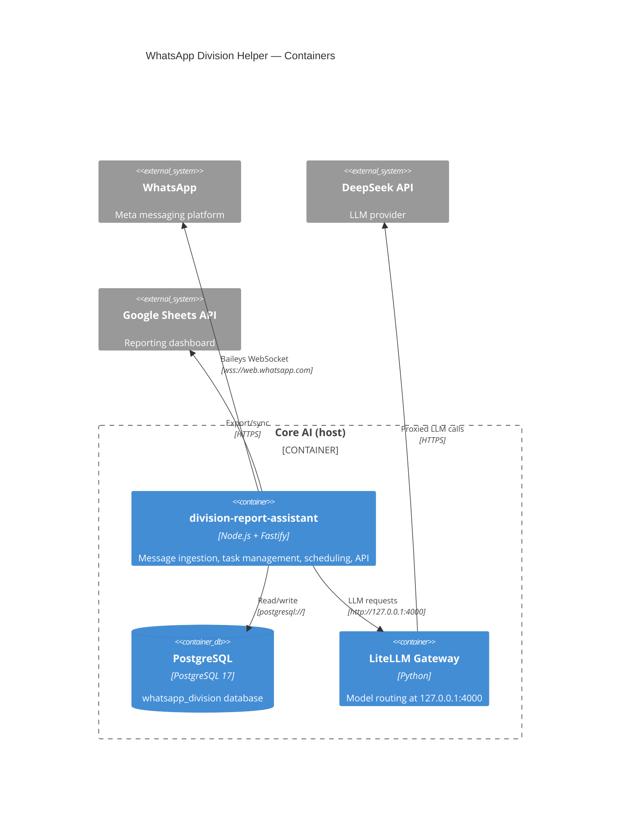
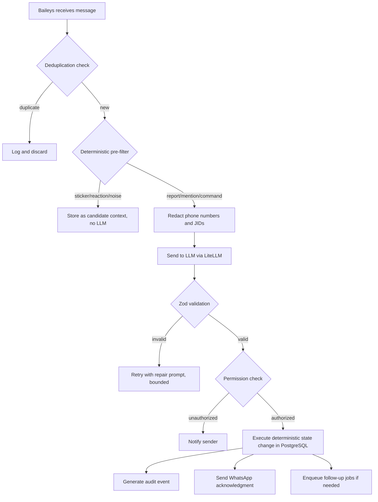
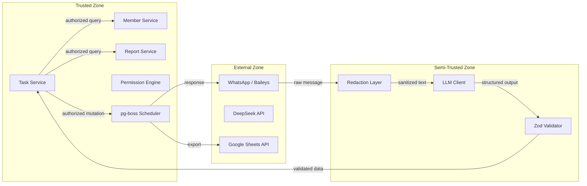
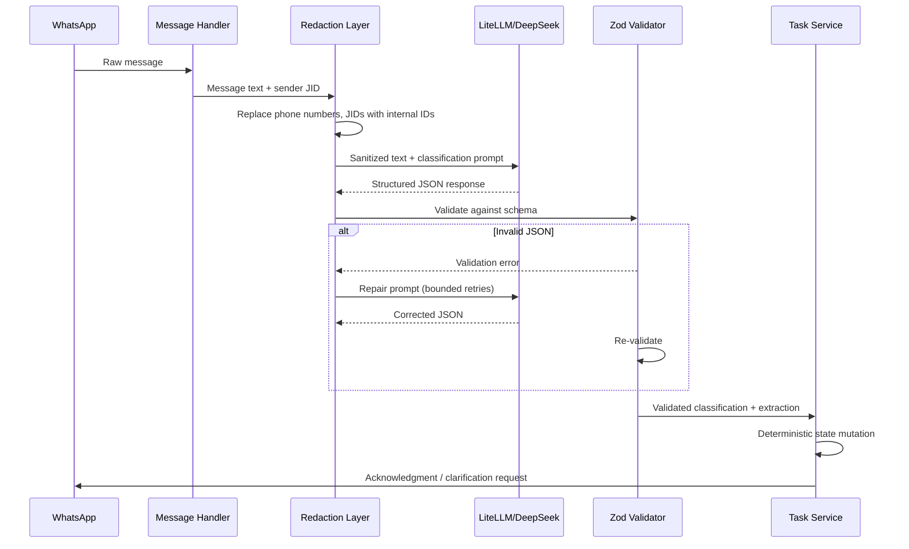
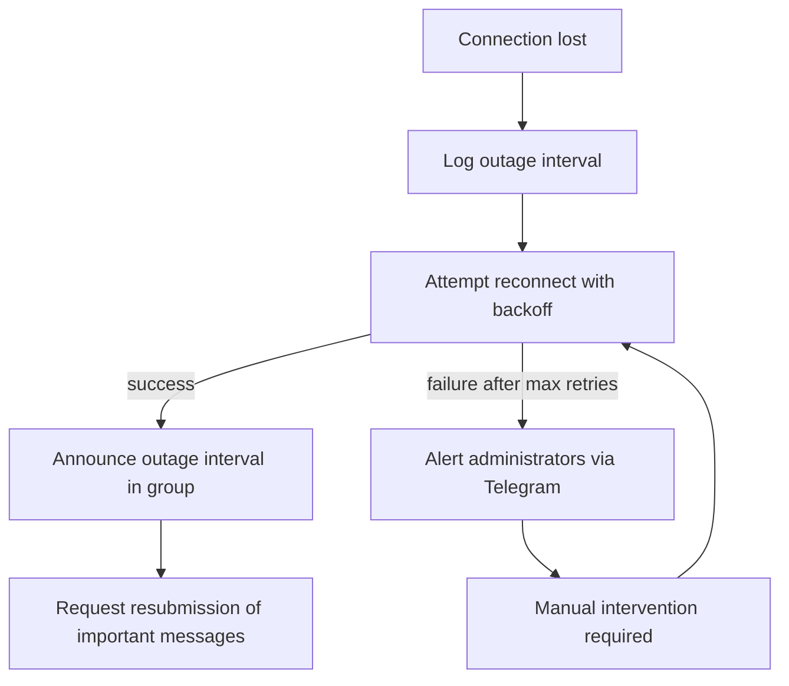
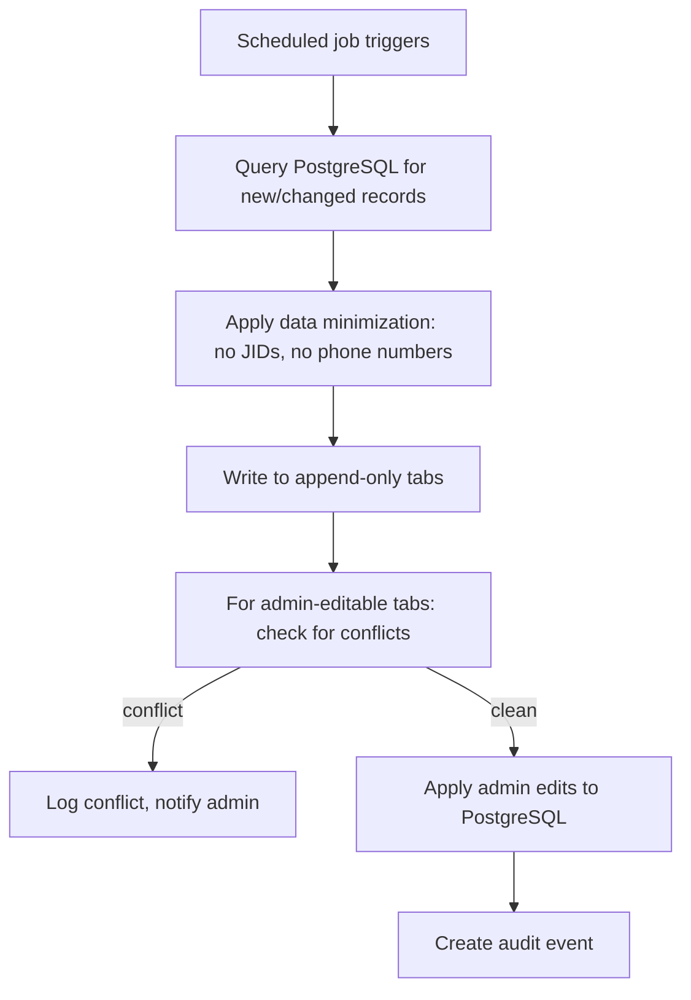

# WhatsApp Division Helper — Architecture Proposal

> **Document type:** Architecture design  
> **Status:** Phase 0 — documentation only  
> **Target:** TypeScript + Fastify modular monolith on Docker  
> **See also:** [MASTER_SPEC.md](MASTER_SPEC.md), [REPOSITORY_REVIEW.md](REPOSITORY_REVIEW.md)

---

## 1. Context Diagram



---

## 2. Container Diagram



**Key decision:** LiteLLM is used as the LLM gateway (consistent with all other AI services in the repo). DeepSeek V4 Flash is added as a new model alias in the LiteLLM config rather than calling the DeepSeek API directly.

---

## 3. Module Boundaries

```text
src/
├── app/                    # Fastify app bootstrap, plugin registration
├── config/                 # Environment, secrets, typed config (Zod-validated)
├── whatsapp/               # Baileys adapter interface + implementation
├── messages/               # Ingestion, deduplication, candidate context
├── members/                # Member service, identity resolution
├── attendance/             # Leave/sick/izin status management
├── projects/               # Project CRUD, confirmation workflow
├── tasks/                  # Task service, state machine, assignments
├── reports/                # Daily report parsing, storage, revisions
├── obstacles/              # Obstacle tracking and resolution
├── reminders/              # Scheduled message generation
├── summaries/              # Morning summary, weekly wrap-up
├── sheets/                 # Google Sheets sync adapter
├── llm/                    # DeepSeek client, redaction, Zod schemas, cost tracking
├── jobs/                   # pg-boss job definitions and handlers
├── audit/                  # Audit event logging
├── health/                 # /healthz and /readyz endpoints
└── shared/                 # Types, errors, time helpers (Asia/Jakarta), logging
```

### Module Dependency Rules

1. `llm/` never imports from `tasks/`, `reports/`, or `members/` — it receives pre-formatted context.
2. `tasks/`, `reports/`, `members/` never import from `llm/` — they consume LLM output as validated data.
3. `whatsapp/` is an adapter — the rest of the app depends on the interface, not the Baileys implementation.
4. `jobs/` depends on `tasks/`, `reports/`, `members/`, `sheets/` — it orchestrates scheduled work.
5. `shared/` has no upward dependencies.

---

## 4. Data Flow — Message Processing



---

## 5. Trust Boundaries



**The LLM never directly mutates state.** All mutations go through deterministic service code after Zod validation.

---

## 6. LLM Call Flow



---

## 7. WhatsApp Reconnect Flow



**No automatic backlog processing on reconnect.** The user must manually trigger reprocessing of specific messages.

---

## 8. Google Sheets Sync Flow



Sync is **one-way by default** (PostgreSQL → Sheets). Limited two-way edits only on specific tabs (TASKS: title, project, status, deadline, assignees, notes, active).

---

## 9. Failure Mode Matrix

| Failure | Impact | Mitigation |
|---------|--------|------------|
| WhatsApp disconnect | No messages received/sent | Reconnect with backoff, alert admin, no backlog processing |
| DeepSeek API down | Cannot classify messages | Deterministic fallback for simple queries, queue for later, alert admin |
| DeepSeek invalid response | Cannot extract data | Bounded retry with repair prompt, then ask user for clarification |
| PostgreSQL down | Cannot persist state | Reject all mutations, queue WhatsApp send attempts, alert admin |
| Google Sheets API down | Dashboard stale | Continue WhatsApp processing unaffected, retry sync later |
| pg-boss failure | Scheduled outputs miss | Restart recovery, missed jobs logged, manual catch-up |
| Baileys session invalid | WhatsApp access lost | Re-pair required, documented recovery procedure |
| LLM budget exhausted | No more LLM calls | Hard-limit degradation mode, deterministic processing only |
| Container OOM | Service crash | Docker restart policy, resource limits configured |

---

## 10. Deployment Resources (Core AI)

| Resource | Allocation |
|----------|-----------|
| Container | `division-report-assistant` |
| Image | Custom Node.js 22 LTS (Alpine or Slim) |
| RAM | 512 MB limit, 256 MB reservation |
| CPU | 0.5 limit, 0.25 reservation |
| PIDs | 256 |
| Volume | `/opt/app/data/division-report-assistant/` (sessions, state) |
| Secrets | `/opt/app/secrets/division-report-assistant/` (env_file) |
| Port | Not published to host (internal only) |
| Network | `monitoring` (for health checks) + internal |
| PostgreSQL | Shared instance, database `whatsapp_division` |
| Health | `/healthz` (liveness), `/readyz` (readiness) |

---

## 11. Port Allocation

Following the existing convention:

| Service | Port | Binding |
|---------|------|---------|
| LiteLLM | 4000 | 127.0.0.1 |
| Context MCP | 8010 | 127.0.0.1 |
| Ops MCP | 8011 | 127.0.0.1 |
| Community Ops MCP | 8012 | 127.0.0.1 |
| Search MCP | 8013 | 127.0.0.1 |
| Smoke | 8080 | 127.0.0.1 |
| **WDH (proposed)** | **8020** | **127.0.0.1** |

---

## 12. Backup Integration

- Add PostgreSQL `pg_dump` for `whatsapp_division` to the existing Restic backup flow;
- include session state volume in backup scope;
- exclude WhatsApp auth secrets from backup (regenerable via re-pair);
- test restore procedure alongside existing `postgres-restore-drill`.
